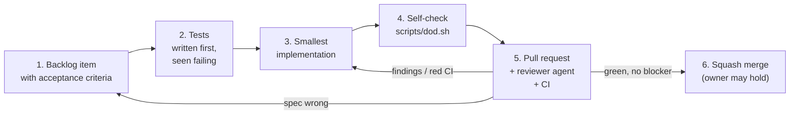

# AI-assisted workflow

This repository is developed by one engineer with LLM coding agents. The
aim is that every change stays **reviewable, verifiable and traceable**.
Agent instructions are in `CLAUDE.md` at the repository root.

## Principles

1. **The human owns requirements and decisions; agents implement within
   them.** Requirements, backlog items and ADRs are written (or approved) by
   a person before an agent writes code.
2. **Specs are contracts.** An agent sees only the repository. A backlog item
   with acceptance criteria and links to requirements and ADRs is the whole
   brief.
3. **Tests first.** Acceptance criteria become tests, run and seen failing,
   before the implementation exists.
4. **Machines check what they can.** Architecture check, sanitizers,
   clang-tidy, strict docs build and the anchor checker catch whole classes of
   mistakes; human review concentrates on design and on whether the tests
   test the right thing.
5. **Claims require evidence.** "Tests pass" means the command was run and
   its output is shown. A check that was not run is reported as not run.
   (The same principle the tool applies to LLM documentation.)

## The loop

## Branches, pull requests and merge

Decision: [ADR-0011](adr/0011-pull-request-flow-with-agent-review.md).

- One branch per backlog item, `b/NN-short-name`; other changes
  `<type>/short-name`. Nothing is committed to `main` directly.
- The pull request follows `.github/pull_request_template.md`: backlog
  item, the failing-test output, the `scripts/dod.sh` summary, review notes.
- The `reviewer` agent reviews every pull request; its findings are posted
  as a `COMMENT` review (agents act through the owner's account, which
  cannot approve its own pull request).
- The agent merges (squash) when CI is green, no blocker or major finding
  is open and the owner has not asked to hold. The owner reads pull
  requests when they choose, and can hold, merge or revert at any time.
- A pull request that adds an ADR, or adds or bumps a versioned anchor in
  `docs/specs/` or `docs/plan/`, waits for the owner's explicit approval
  ([ADR-0011](adr/0011-pull-request-flow-with-agent-review.md#adr0011-owner-approves-decisions-v1)).

## Agents and skills

| Step | Agent (`.claude/agents/`) | Skill (`.claude/skills/`) |
|---|---|---|
| 2–6 for one backlog item | `developer` (optional, for a fresh context) | `/implement B-NN` |
| 5. Review | `reviewer`: no edit tools, checklist below | `/review [PR \| branch]` |
| Keeping a pull request green | – | `steward`: CI job ↔ local command, known failures |

Scripts: `scripts/quick-check.sh` (inner loop, one preset, errors only) and
`scripts/dod.sh` (every local check, one line each; logs in `build/logs/`).

Kept small on purpose: the backlog item is the spec (no separate task
files), and there is no separate verifier, analyst or architect agent.
Agent files name no model; they use the session's. Instructions point to
CLAUDE.md, this page, ADRs and `.claude/rules/`, and never restate a rule
in other words; when a rule changes, change it at its source.

## Review checklist for LLM-written changes

| Look for | Why |
|---|---|
| Tests weakened to pass: assertions removed, expected values copied from actual output, golden files regenerated without review | the most common way a wrong change "passes" |
| Invented APIs: Clang, SQLite, toml++ or libmodbus functions or flags that do not exist in the pinned versions | plausible and wrong; check against the headers |
| Hidden nondeterminism: hash-map iteration, unsorted directory listing, timestamps in facts | breaks NFR-004 silently |
| Boundary erosion: core code including `llm/`, Clang types outside `analysis` | the build checks linking; review checks intent |
| Changes to what leaves `lcart`: bundle content (`handoff`), the prompt, `--include-source`, and in M6 `llm/egress_policy.hpp` | the privacy guarantee lives there |
| Unverified statements in docs: facts about libmodbus or Clang without a source | mark them "TODO: verify" and list them in [open questions](open-questions.md) |
| Scope creep: refactoring mixed with behaviour change | harder to review |
| Over-mocking: tests asserting that a fake was called instead of behaviour | passes while the system is broken |

## Definition of Done (every change)

- Acceptance criteria of the backlog item pass, with tests that cite the
  requirement anchors.
- `scripts/dod.sh` is all PASS (GCC, Clang with ASan/UBSan and Clang with
  TSan from Ubuntu packages, format, clang-tidy, docs check, targets), and
  CI is green on the pull request (adds the Conan presets `debug`,
  `clang-debug`, `release`, `asan-ubsan`).
- New decisions have an ADR; docs, roadmap checkboxes and open questions are
  updated.
- No `TODO` without a backlog or milestone reference (`TODO(B-07)`,
  `TODO(M2)`); no suppression without a reason on the same line.

## Lessons learned

Cases where LLM output was wrong and how it was caught, newest first:
what was produced, why it was wrong, how it was caught (test, sanitizer,
review, CI), what now prevents a repeat.

None recorded yet.
