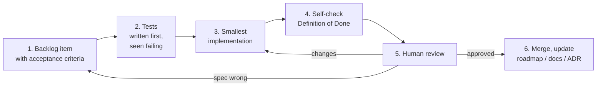

# AI-assisted workflow

This repository is developed by one engineer with LLM coding agents. The
aim is that every change stays **reviewable, verifiable and traceable**.
Agent instructions are in `CLAUDE.md` at the repository root.

## Principles

1. **The human owns requirements and decisions; agents implement within
   them.** Requirements, backlog items and ADRs are written (or approved) by
   a person before an agent writes code.
2. **Specs are contracts.** An agent sees only the repository. A backlog item
   with acceptance criteria and links to requirements and ADRs is the whole
   brief.
3. **Tests first.** Acceptance criteria become tests, run and seen failing,
   before the implementation exists.
4. **Machines check what they can.** Architecture check, sanitizers,
   clang-tidy, strict docs build and the anchor checker catch whole classes of
   mistakes; human review concentrates on design and on whether the tests
   test the right thing.
5. **Claims require evidence.** "Tests pass" means the command was run and
   its output is shown. A check that was not run is reported as not run.
   (The same principle the tool applies to LLM documentation.)

## The loop

## Review checklist for LLM-written changes

| Look for | Why |
|---|---|
| Tests weakened to pass: assertions removed, expected values copied from actual output, golden files regenerated without review | the most common way a wrong change "passes" |
| Invented APIs: Clang, SQLite or libmodbus functions or flags that do not exist in the pinned versions | plausible and wrong; check against the headers |
| Hidden nondeterminism: hash-map iteration, unsorted directory listing, timestamps in facts | breaks NFR-004 silently |
| Boundary erosion: core code including `llm/`, Clang types outside `analysis` | the build checks linking; review checks intent |
| Egress changes: anything touching `llm/egress_policy.hpp` or what goes into a prompt | the privacy guarantee lives there |
| Unverified statements in docs: facts about libmodbus or Clang without a source | mark them "TODO: verify" and list them in [open questions](open-questions.md) |
| Scope creep: refactoring mixed with behaviour change | harder to review |
| Over-mocking: tests asserting that a fake was called instead of behaviour | passes while the system is broken |

## Definition of Done (every change)

- Acceptance criteria of the backlog item pass, with tests that cite the
  requirement anchors.
- Build and tests pass on all presets (`debug`, `clang-debug`, `release`,
  `asan-ubsan`; `debug-system` where Conan is unavailable).
- `scripts/check-format.sh`, `scripts/run-clang-tidy.sh` and
  `scripts/docs-check.sh` are clean.
- New decisions have an ADR; docs, roadmap checkboxes and open questions are
  updated.
- No `TODO` without a backlog or milestone reference (`TODO(B-07)`,
  `TODO(M2)`); no suppression without a reason on the same line.
