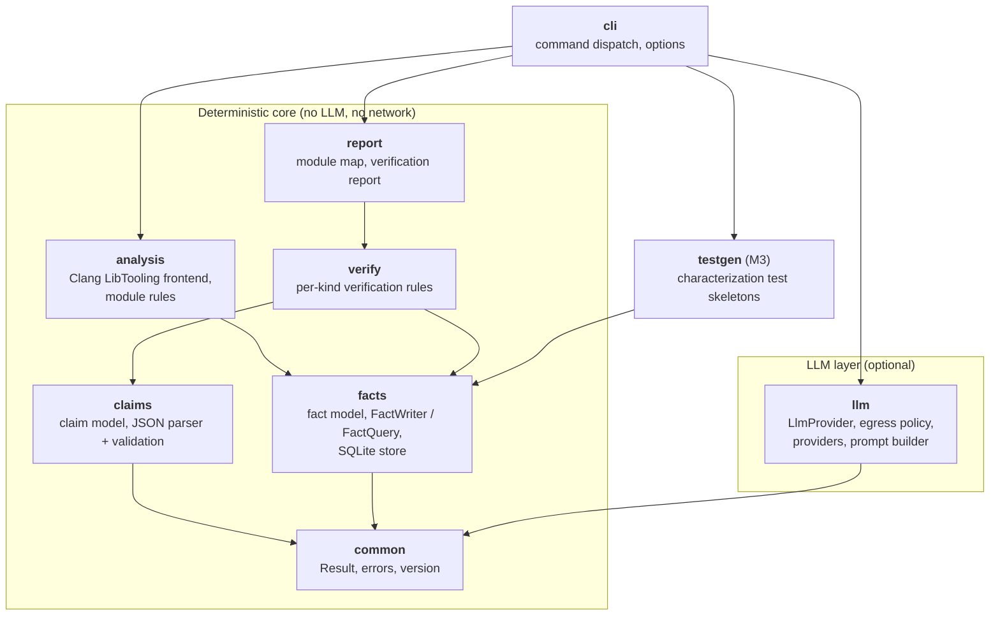

# C4 level 3: components of `lcart`

Each component is a module under `src/` and a CMake target `lcart::<name>`.
Arrows are build dependencies (who includes and links whom).

No module of the deterministic core may depend on `llm`; the build fails at
configure time if one does (`cmake/ArchitectureRules.cmake`).

The `llm` module does not depend on `facts` directly: the `document` command
in `cli` reads facts, builds prompts through `llm`, and passes the returned
claims to `verify`. This keeps the LLM layer replaceable and testable with a
stub provider. (Where the prompt builder lives is decided in M2; see
[open questions](../open-questions.md).)
