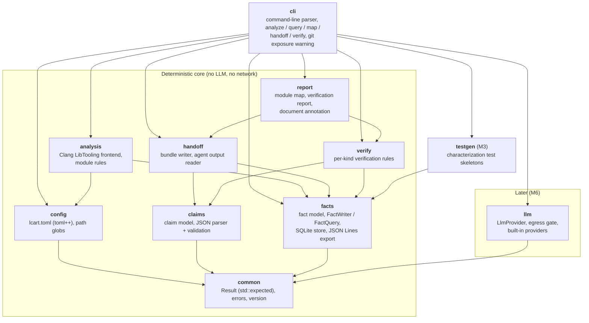

# C4 level 3: components of `lcart`

Each component is a module under `src/` and a CMake target `lcart::<name>`.
Arrows are build dependencies (who includes and links whom).

No module of the deterministic core may depend on `llm`; the build fails at
configure time if one links it (`cmake/ArchitectureRules.cmake`), and a
test (label `architecture`) fails if one includes a header from `src/llm/`
or if a Clang or LLVM header is included outside `analysis`
(`cmake/CheckIncludeBoundaries.cmake`).

The `ingest` command in `cli` chains the core: `handoff::read_agent_output`
→ `verify::verify_claim` for each claim → `report` writes the annotated
documents and the report. Nothing in this chain needs an LLM, so recorded
agent outputs make it fully testable.
