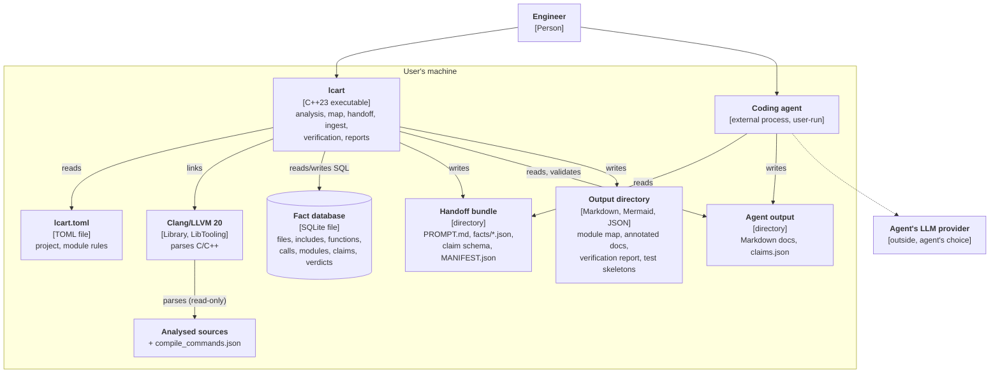

# C4 level 2: containers

Notes:

- One process, one database file per analysed project. There is no server
  and no background service. `lcart` opens no network connection in v1.
- The fact database, bundles and outputs contain names (and, with
  `--include-source`, excerpts) of the analysed project. They are as
  sensitive as the code ([security](../security.md)).
- Configuration format: [ADR-0008](../adr/0008-configuration-file-format.md).
