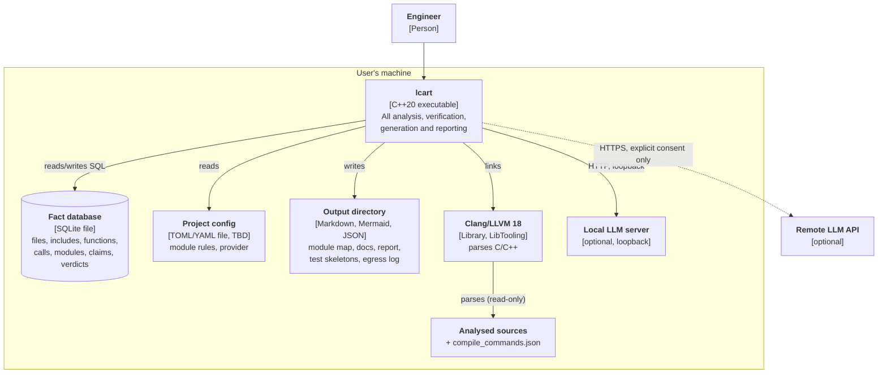

# C4 level 2: containers

Notes:

- One process, one database file per analysed project. There is no server
  and no background service.
- The fact database and the output directory may contain the analysed
  project's source code (excerpts, names). They are as sensitive as the code
  itself ([security](../security.md)).
- The configuration file format is an open question
  ([open questions](../open-questions.md)).
