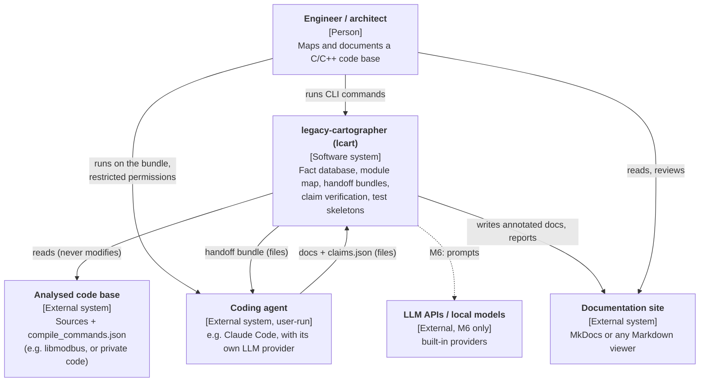

# C4 level 1: system context

**Trust boundaries.** The analysed code and everything the agent returns are
untrusted input. In v1 `lcart` itself sends nothing over the network; the
bundle reaches an LLM provider only through the agent the user chooses and
configures ([security](../security.md)).
