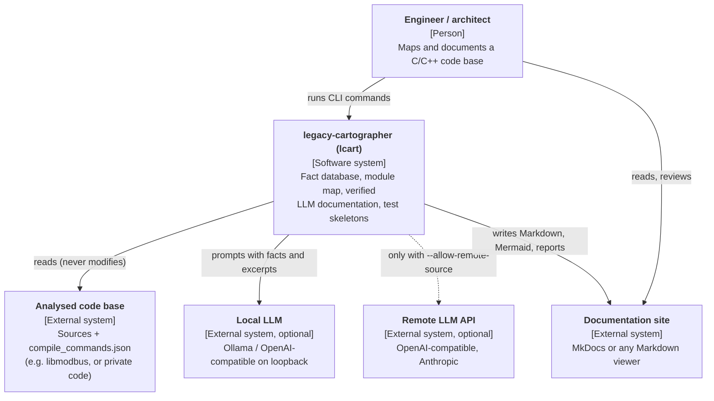

# C4 level 1: system context

**Trust boundaries.** The analysed code and everything the LLM returns are
untrusted input. The remote API is outside the machine: crossing that
boundary with source code requires explicit, per-invocation consent
([security](../security.md)).
