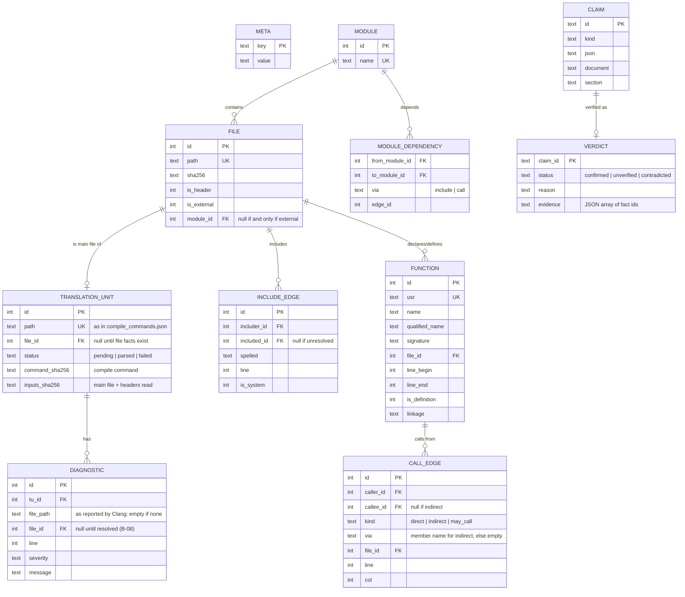

# Fact database data model

One SQLite file per analysed project. Schema version 1
(`facts::schema_version` in `src/facts/fact_model.hpp`); any change bumps it.
Paths are relative to the analysis root with `/` separators.

## Rules

- `META` holds `schema_version`, `tool_version`, `analysis_root`, the
  SHA-256 of `compile_commands.json` and the coverage counts
  (`translation_units_total`, `translation_units_parsed`). No timestamps in
  fact tables
  ([NFR-004](../specs/requirements.md#nfr004-deterministic-output-v1)).
- Opening a database whose `schema_version` differs from the tool's, or a
  SQLite file without `META`, is an error; there is no migration in v1
  (re-run the analysis).
- Row ids are assigned in a deterministic insertion order (TUs sorted by
  path, declarations in source order), so ids are stable across runs on the
  same input.
- Functions are identified by USR; the same function seen from several TUs
  is one row, located at its definition once one is seen. Modules are unique
  by name and files by path; adding a known one returns its id.
- `MODULE_DEPENDENCY` is derived from `INCLUDE_EDGE` and direct
  `CALL_EDGE`s after analysis and keeps the justifying edge, so `depends_on`
  claims have evidence. Until B-11 fills the table, `module_dependencies()`
  derives the same set on each query.
- `kind = 'indirect'` if and only if `callee_id` is null; `may_call` edges
  ([FR-015](../specs/requirements.md#fr015-resolve-function-pointer-tables-v1)) are never returned with direct calls.
- Claims and verdicts live in the same file so a report can be regenerated
  without the LLM.
- Each TU's facts are committed in one transaction together with its
  `status`, so an interrupted analysis resumes from the TUs still `pending`
  ([NFR-005](../specs/requirements.md#nfr005-performance-budget-v2)). The
  per-TU hashes allow incremental re-analysis later.
- All SQL uses bound parameters; analysed names are never concatenated into
  SQL ([security](../security.md)).
- The physical DDL is `schema_sql` in `src/facts/src/sqlite_fact_store.cpp`
  (`STRICT` tables, foreign keys on, `CHECK` constraints for the rules above);
  this page is its specification.
