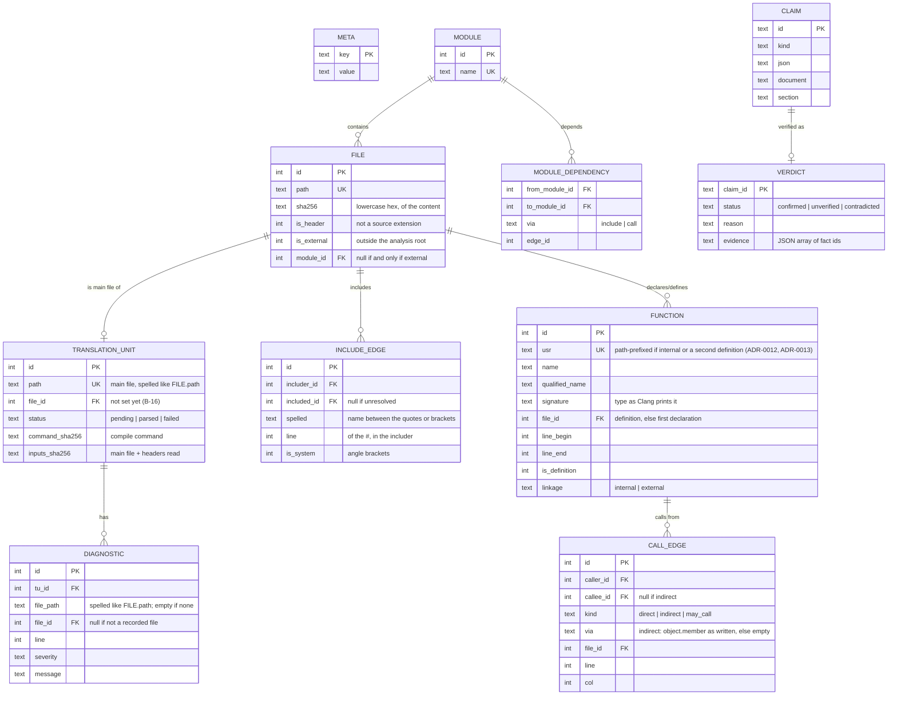

# Fact database data model

One SQLite file per analysed project. Schema version 2
(`facts::schema_version` in `src/facts/fact_model.hpp`); any change bumps it
(2: translation unit and diagnostic paths spelled like file paths, B-12).
Paths of files under the analysis root are relative to it, with `/`
separators; files outside it have absolute paths
([file facts](#arch-data-model-file-facts-v1)). How functions are
identified: [function facts](#arch-data-model-function-facts-v2),
[call edges](#arch-data-model-call-edges-v1); how files get modules and
modules dependencies: [modules](#arch-data-model-modules-v1).

## Rules

- `META` holds `schema_version`, `tool_version`, `analysis_root`, the
  SHA-256 of `compile_commands.json` and the coverage counts
  (`translation_units_total`, `translation_units_parsed`). No timestamps in
  fact tables
  ([NFR-004](../specs/requirements.md#nfr004-deterministic-output-v1)).
- Opening a database whose `schema_version` differs from the tool's, or a
  SQLite file without `META`, is an error; there is no migration in v1
  (re-run the analysis).
- Row ids are assigned in a deterministic insertion order (TUs sorted by
  path, declarations in source order), so ids are stable across runs on the
  same input.
- Functions are identified by USR; the same function seen from several TUs
  is one row, located at its definition once one is seen. Modules are unique
  by name and files by path; adding a known one returns its id.
- `MODULE_DEPENDENCY` is derived from `INCLUDE_EDGE` and direct
  `CALL_EDGE`s after analysis and keeps the justifying edge, so `depends_on`
  claims have evidence ([modules](#arch-data-model-modules-v1)).
- `kind = 'indirect'` if and only if `callee_id` is null; `may_call` edges
  ([FR-015](../specs/requirements.md#fr015-resolve-function-pointer-tables-v1)) are never returned with direct calls.
- Claims and verdicts live in the same file so a report can be regenerated
  without the LLM.
- Each TU's facts are committed in one transaction together with its
  `status`, so an interrupted analysis resumes from the TUs still `pending`
  ([NFR-005](../specs/requirements.md#nfr005-performance-budget-v2)). The
  per-TU hashes allow incremental re-analysis later.
- All SQL uses bound parameters; analysed names are never concatenated into
  SQL ([security](../security.md)).
- The physical DDL is `schema_sql` in `src/facts/src/sqlite_fact_store.cpp`
  (`STRICT` tables, foreign keys on, `CHECK` constraints for the rules above);
  this page is its specification.

## File and include facts

How [FR-002](../specs/requirements.md#fr002-record-files-and-includes-v1)
maps onto `FILE` and `INCLUDE_EDGE` (B-08):

- Paths are canonical (symlinks and `..` resolved) before they are compared
  with the canonical analysis root, so one file has one row however it was
  reached.
- A file is a header unless its extension is a source extension (`.c`,
  `.C`, `.cc`, `.cpp`, `.cxx`, `.c++`, `.m`, `.mm`), so a `.c` file that is
  `#include`d is still a source and `.inc` files are headers.
- A file under the root gets a module: the first matching rule, or the
  default of [FR-005](../specs/requirements.md#fr005-map-files-to-modules-v1)
  (top-level directory, or `(root)`); see [modules](#arch-data-model-modules-v1).
- A file outside the root (system and third-party headers) is recorded only
  when a file under the root includes it directly, with its absolute path
  (the facts export names it by the spelling of its first directive,
  [ADR-0016](../adr/0016-facts-export-and-command-line.md#adr0016-paths-outside-root-v1);
  for bundles it is an
  [open question](../open-questions.md#open-technical-questions)).
  Directives inside it are not recorded, so the database does not grow with
  the system's headers.
- A file under the root forced in with `-include` is recorded although no
  directive names it (no edge: the includer is the command line).
- An `#include` directive is recorded once per (includer, line, spelling,
  target), although a header is reached from many translation units.
  `is_system` is the spelling (`<...>`), not where the file was found.
- An unresolved include has no target and keeps its spelling; Clang reports
  it as a fatal error, so its translation unit also counts as failed.

## Function facts

How [FR-003](../specs/requirements.md#fr003-record-functions-v1) maps onto
`FUNCTION` (B-09):

- Only functions whose declaration is in a file under the root are
  recorded; `printf` declared in `<stdio.h>` is not. Compiler-generated
  declarations, lambda call operators and deduction guides are skipped, and
  so are template instantiations (the template itself is recorded).
- `usr` is Clang's USR; for a function with internal linkage it is
  prefixed with the root-relative path of the file of its definition (else
  of its first declaration) and `#`, e.g. `left/util.c#c:util.c@F@helper`
  ([ADR-0012](../adr/0012-function-identity-for-internal-linkage.md#adr0012-internal-linkage-usr-v1)),
  because Clang's USR then names only the base name of a file. Two `static`
  functions in `left/util.c` and `right/util.c`, or two definitions of a
  `static` declared in one shared header, are two rows; a `static inline`
  function defined in a header is one row.
- `linkage` is `external` if the function is visible outside its
  translation unit, else `internal` (`static`, anonymous namespace).
- `signature` is the function's type as Clang prints it, without parameter
  names: `size_t (const char *)`, `int (int, ...)`.
- File and lines are those of the definition once one is seen, else of the
  first declaration seen (translation units are analysed in path order). The
  line range runs from the first token (`static`, the return type) to the
  closing brace or semicolon. A function written by a macro is located at
  the macro's use.
- A function with external linkage defined at two places (two programs'
  `main` in one compilation database) is two rows: the first definition in
  path order keeps Clang's USR, a later one gets its file's path and `#` in
  front (`two/main.c#c:@F@main`), and the analysis reports a warning
  ([ADR-0013](../adr/0013-functions-with-external-linkage-defined-twice.md#adr0013-each-definition-a-function-v1)).
  One definition reached from several translation units (a header) is one
  row.

## Call edges

How [FR-004](../specs/requirements.md#fr004-record-call-edges-v1) maps onto
`CALL_EDGE` (B-10):

- Every call expression in the body of a recorded definition is one edge,
  in source order: a function called twice is two edges. Calls in a lambda
  belong to the enclosing function. A function named without being called
  (`apply(checksum, ...)`) is not an edge, and neither is a call in an
  operand of `sizeof` or `alignof`, which is never evaluated.
- `direct`: the callee is the function the call names, as the caller's
  translation unit sees it: its own (last) definition of that name if it
  has one, else the function its USR names
  ([ADR-0013](../adr/0013-functions-with-external-linkage-defined-twice.md#adr0013-each-definition-a-function-v1)).
  A translation unit that only declares a function defined twice calls the
  first definition. A call to a function that is
  not recorded (declared outside the root, such as `strlen`, or a builtin)
  is not an edge, because `callee_id` must name a `FUNCTION`.
- `indirect`: there is no named callee (a function pointer, a struct member
  function pointer). `via` is the called member and the member or variable
  it is read from, as written: `ctx->backend->recv(...)` gives
  `backend.recv`, `local.recv(...)` gives `local.recv`; when the object is
  neither (`get()->recv(...)`, `table[i].recv(...)`) `via` is the member
  alone, `recv`; a plain function pointer (`handler(...)`, `(*handler)(...)`)
  gives an empty `via`.
- The site is the first character of the call; a call written in a macro
  is located at the macro's use, and belongs to the function where the
  macro expands.
- The calls of a function are recorded once, from the translation unit that
  writes its definition, although a body in a header is seen by many.
- C++ gaps (the M1 targets are C): in a template, a call that depends on a
  template parameter is not recorded (it is resolved only in
  instantiations, which are not recorded); other calls in a template are. A
  call to a function template's specialization is not recorded, because the
  specialization is not a recorded function. Calls in a constructor's
  member initializers are not recorded (they are not in its body), nor are
  constructor calls themselves (not call expressions in Clang). A virtual
  call is `direct` to the method it names.

## Modules and module dependencies

How [FR-005](../specs/requirements.md#fr005-map-files-to-modules-v1) maps
onto `MODULE`, `FILE.module_id` and `MODULE_DEPENDENCY` (B-11):

- The rules are the `[[modules]]` tables of `lcart.toml`, in file order. A
  file under the root belongs to the first rule with a path glob matching
  its whole root-relative path
  ([ADR-0014](../adr/0014-path-globs-in-the-configuration.md#adr0014-path-glob-syntax-v1)),
  else to its top-level directory, or `(root)` for a file directly in the
  root. A `MODULE` row exists for every module that has a file; a rule that
  matches no file creates none.
- `[project] exclude` removes translation units before analysis; a header
  that matches is still recorded when an analysed unit includes it
  ([ADR-0014](../adr/0014-path-globs-in-the-configuration.md#adr0014-exclude-selects-translation-units-v1)).
- After the last translation unit, `MODULE_DEPENDENCY` is replaced in one
  transaction: one row per include edge from a file of one module to a file
  of another (`via = 'include'`), and one per direct call edge from a
  function of one module to a function of another (`via = 'call'`), with
  the edge's id. A function belongs to the module of the file it is located
  in: its definition, else its first declaration. Edges within a module,
  to external files, unresolved includes and indirect calls justify
  nothing.
- `module_dependencies()` lists the modules depended on by name;
  `module_dependency_edges()` lists the justifying edges with the directive
  (file and line) or call site (file, line and column).
