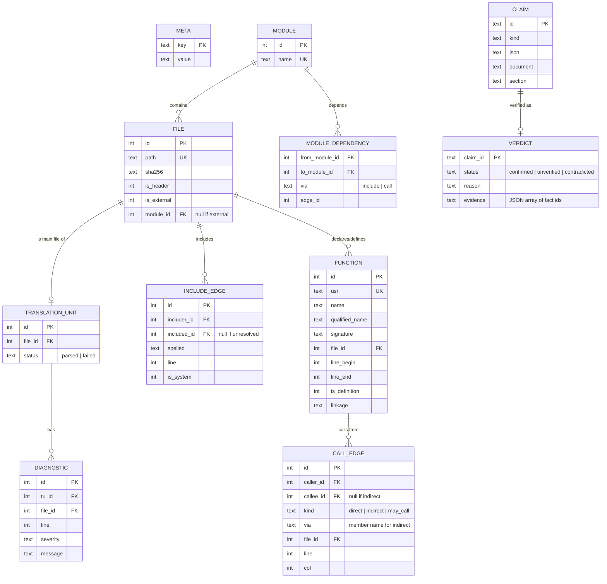

# Fact database data model

One SQLite file per analysed project. Schema version 1
(`facts::schema_version` in `src/facts/fact_model.hpp`); any change bumps it.
Paths are relative to the analysis root with `/` separators.

## Rules

- `META` holds `schema_version`, `tool_version`, `analysis_root` and the
  SHA-256 of `compile_commands.json`. No timestamps in fact tables
  ([NFR-004](../specs/requirements.md#nfr004-deterministic-output-v1)).
- Row ids are assigned in a deterministic insertion order (TUs sorted by
  path, declarations in source order), so ids are stable across runs on the
  same input.
- Functions are identified by USR; the same function seen from several TUs
  is one row.
- `MODULE_DEPENDENCY` is derived from `INCLUDE_EDGE` and `CALL_EDGE` after
  analysis and keeps the justifying edge, so `depends_on` claims have
  evidence.
- Claims and verdicts live in the same file so a report can be regenerated
  without the LLM.
- All SQL uses bound parameters; analysed names are never concatenated into
  SQL ([security](../security.md)).
- The physical DDL is written in B-06; this page is its specification.
