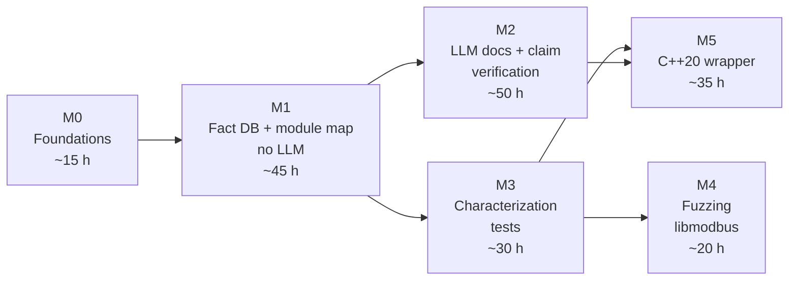

# Roadmap

Milestones are delivered in order. Each ends in a usable state: the tool
does something useful at the end of M1 even if M2 never happens.

Effort is in hours of focused work (at 4–6 h/week, divide by ~5 for weeks).
Estimates before M1 are guesses; they are revised at each milestone's end.

## **[M0 v1]** Foundations

**Goal:** a repository in which work can start safely: it builds, tests and
documents itself in CI.

**Scope:** repository skeleton, CMake presets, Conan, CI (build, sanitizers,
format, clang-tidy, docs), MkDocs site, specs, ADRs 0001–0005, module
interfaces without logic, libmodbus submodule.

**Requirements:** [NFR-006](../specs/requirements.md#nfr006-toolchain-baseline-v1),
[NFR-007](../specs/requirements.md#nfr007-quality-gates-v1),
[NFR-008](../specs/requirements.md#nfr008-upstream-unmodified-v1),
[NFR-011](../specs/requirements.md#nfr011-licensing-v1),
[NFR-012](../specs/requirements.md#nfr012-traceability-v1) (format part).

**Definition of Done:**

- [ ] CI green on `main` for all presets, lint and docs jobs (B-02, B-03).
- [x] Configure-time architecture check rejects `llm` in the deterministic
      core (verified by a deliberate violation before commit).
- [ ] libmodbus submodule pinned at v3.2.0, CI checks it is clean (B-01).
- [ ] Open questions Q1–Q5 answered or deferred with a date.

## **[M1 v1]** Fact database and module map, without LLM

**Goal:** `lcart analyze` + `lcart map` produce a correct, reproducible
module map and call graph for libmodbus with no LLM and no network.

**Scope:** Clang LibTooling integration, SQLite fact store, files, includes,
functions, direct and indirect calls, module rules, query/export, module map,
libmodbus baseline. Out: function-pointer table resolution (FR-015, M2),
anything LLM.

**Requirements:** [FR-001](../specs/requirements.md#fr001-ingest-compilation-database-v1)–[FR-007](../specs/requirements.md#fr007-module-map-without-llm-v1),
[NFR-001](../specs/requirements.md#nfr001-works-without-llm-v1),
[NFR-004](../specs/requirements.md#nfr004-deterministic-output-v1),
[NFR-005](../specs/requirements.md#nfr005-performance-budget-v1),
[NFR-012](../specs/requirements.md#nfr012-traceability-v1) (test citation check).

**Definition of Done:**

- All acceptance criteria of FR-001–FR-007 have passing tests that cite them.
- Fixture projects and golden files committed; determinism test passes.
- libmodbus module map generated in CI and published in the docs; hand
  check of the functions listed in the [libmodbus plan](../targets/libmodbus.md) done.
- Analysis time for libmodbus recorded (NFR-005 baseline).
- ADR for the threading model of analysis (if it differs from the
  [components page](../architecture/components.md#arch-threading-v1)).

## **[M2 v1]** LLM documentation and claim verification

**Goal:** generated documentation for libmodbus with a verification report,
working fully locally.

**Scope:** claim parser + fuzzer, verifier, report, provider interface and
three providers, egress gate, egress log, dry run, prompt builder,
function-pointer table resolution, labelled claim set.

**Requirements:** [FR-008](../specs/requirements.md#fr008-generate-documentation-v1)–[FR-015](../specs/requirements.md#fr015-resolve-function-pointer-tables-v1),
[NFR-002](../specs/requirements.md#nfr002-no-source-egress-by-default-v1),
[NFR-003](../specs/requirements.md#nfr003-fully-local-mode-v1),
[NFR-009](../specs/requirements.md#nfr009-verifier-accuracy-measured-v1),
[NFR-010](../specs/requirements.md#nfr010-untrusted-input-v1).

**Definition of Done:**

- Egress decision table fully tested; end-to-end test with network blocked
  passes with a local stub provider.
- Verifier accuracy measured on ≥ 200 labelled claims and meets NFR-009.
- libmodbus docs + verification report published; contradicted claims shown.
- ADR for the HTTP client library; ADR for the prompt design if it encodes a
  decision others could make differently.

## **[M3 v1]** Characterization tests

**Goal:** generated and hand-completed characterization tests pin
libmodbus's frame handling.

**Scope:** `testgen` module and command; seam for feeding frames; tests for
the receive path, `check_confirmation`, `modbus_reply`.

**Requirements:** [FR-016](../specs/requirements.md#fr016-characterization-test-skeleton-v1).

**Definition of Done:**

- `lcart testgen` output compiles for a fixture and for one libmodbus
  function.
- At least 30 characterization tests over the frame path, passing against
  the pinned libmodbus, under ASan/UBSan.
- Findings (surprising behaviour) documented on the libmodbus page.

## **[M4 v1]** Fuzzing libmodbus

**Goal:** continuous fuzzing of libmodbus's frame parsing without modifying
it.

**Scope:** libFuzzer harness (optional AFL++), seed corpus from the
characterization tests, CI smoke run, coverage report.

**Requirements:** [NFR-010](../specs/requirements.md#nfr010-untrusted-input-v1) (applied to the target), testing strategy.

**Definition of Done:**

- Harness runs 60 s in CI and longer locally with a documented command.
- Coverage of the receive path reported.
- Any crash reproduced as a test and reported upstream per its `SECURITY.md`.

## **[M5 v1]** C++20 wrapper

**Goal:** a small, modern, tested C++20 API over libmodbus that respects the
LGPL obligations.

**Scope:** RAII context, spans, chrono timeouts, `Result` errors, examples;
characterization tests re-run through the wrapper; shared-library linking
check; libmodbus case-study write-up.

**Requirements:** [NFR-011](../specs/requirements.md#nfr011-licensing-v1).

**Definition of Done:**

- Characterization tests pass through the wrapper with identical results.
- CI verifies dynamic linking (`ldd` lists `libmodbus.so`).
- Licence notes in the wrapper's README match
  [ADR-0003](../adr/0003-licensing.md#adr0003-lgpl-wrapper-obligations-v1).
- Case study page: what the tool found, what the LLM got wrong, what the
  verifier caught.
