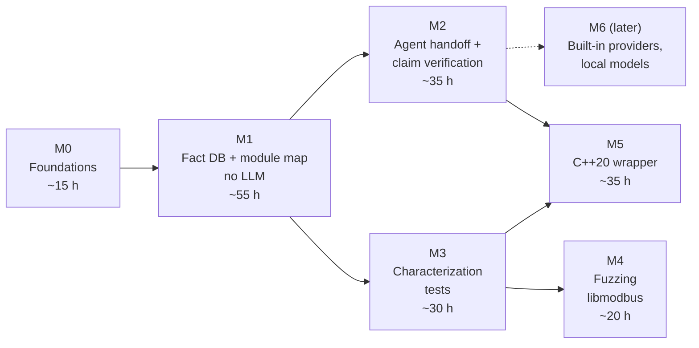

# Roadmap

Milestones are delivered in order. Each ends in a usable state: the tool
does something useful at the end of M1 even if M2 never happens.

Effort is in hours of focused work (at 4–6 h/week, divide by ~5 for weeks).
Estimates before M1 are guesses; they are revised at each milestone's end.

## **[M0 v2]** Foundations

**Status:** done (2026-10-03).

**Goal:** a repository in which work can start safely: it builds, tests and
documents itself in CI.

**Scope:** repository skeleton, CMake presets, Conan, CI (build, sanitizers,
format, clang-tidy, docs), MkDocs site, specs, ADRs 0001–0008, module
interfaces without logic, libmodbus submodule.

**Requirements:** [NFR-006](../specs/requirements.md#nfr006-toolchain-baseline-v2),
[NFR-007](../specs/requirements.md#nfr007-quality-gates-v1),
[NFR-008](../specs/requirements.md#nfr008-upstream-unmodified-v1),
[NFR-011](../specs/requirements.md#nfr011-licensing-v1),
[NFR-012](../specs/requirements.md#nfr012-traceability-v2) (format part).

**Definition of Done:**

- [x] CI green on `main` for all presets, lint and docs jobs (B-02;
      first run 2026-10-03).
- [x] Docs checker has its own tests and was shown to fail on bad input
      (B-03: `tests/docs/`, run in the docs workflow).
- [x] Configure-time architecture check rejects `llm` in the deterministic
      core (verified by a deliberate violation before commit).
- [x] libmodbus submodule pinned at v3.2.0, CI checks it is clean (B-01).
- [x] Open question Q1 (toolchain of private code bases) answered:
      Linux/WSL2 only ([ADR-0009](../adr/0009-linux-and-wsl2-only.md)).

## **[M1 v3]** Fact database and module map, without LLM

**Goal:** `lcart analyze` + `lcart map` produce a correct, reproducible
module map and call graph for libmodbus with no LLM and no network.

**Scope:** Clang LibTooling integration, SQLite fact store, files, includes,
functions, direct and indirect calls, module rules, query/export, module map,
libmodbus baseline, resumable analysis with progress (for runs of hours or
days), MSVC-code spike, traceability matrix. Out: function-pointer table
resolution (FR-015, M2), incremental re-analysis, anything LLM.

**Requirements:** [FR-001](../specs/requirements.md#fr001-ingest-compilation-database-v1)–[FR-007](../specs/requirements.md#fr007-module-map-without-llm-v1),
[NFR-001](../specs/requirements.md#nfr001-works-without-llm-v1),
[NFR-004](../specs/requirements.md#nfr004-deterministic-output-v1),
[NFR-005](../specs/requirements.md#nfr005-performance-budget-v2),
[NFR-012](../specs/requirements.md#nfr012-traceability-v2) (citation gate and matrix),
[NFR-013](../specs/requirements.md#nfr013-linux-and-wsl2-v1).

**Definition of Done:**

- All acceptance criteria of FR-001–FR-007 have passing tests that cite them.
- Fixture projects and golden files committed; determinism test passes.
- libmodbus module map generated in CI and published in the docs; hand
  check of the functions listed in the [libmodbus plan](../targets/libmodbus.md) done.
- Analysis time for libmodbus recorded (NFR-005 baseline).
- Repository made public ([publication](#publication)).
- A ruleset on `main` requires a pull request and the CI checks
  ([ADR-0011](../adr/0011-pull-request-flow-with-agent-review.md#adr0011-merge-on-green-v1)).
- ADR for the threading model of analysis (if it differs from the
  [components page](../architecture/components.md#arch-threading-v1)).

## **[M2 v2]** Agent handoff and claim verification

**Goal:** documentation of libmodbus written by an external coding agent
from a handoff bundle, with every structural claim verified
([ADR-0006](../adr/0006-external-agent-handoff-for-llm-work.md)).

**Scope:** handoff bundle and prompt, `lcart ingest`, claim parser + fuzzer,
verifier, report and document annotation, function-pointer table
resolution, labelled claim set, ready agent permission configuration. Out:
built-in providers, local models (M6).

**Requirements:** [FR-008](../specs/requirements.md#fr008-generate-documentation-v2)–[FR-011](../specs/requirements.md#fr011-verification-report-v2),
[FR-015](../specs/requirements.md#fr015-resolve-function-pointer-tables-v1),
[NFR-002](../specs/requirements.md#nfr002-no-source-egress-by-default-v2),
[NFR-009](../specs/requirements.md#nfr009-verifier-accuracy-measured-v1),
[NFR-010](../specs/requirements.md#nfr010-untrusted-input-v1).

**Definition of Done:**

- Golden bundle and recorded agent output tests pass; all M2 tests pass
  with network blocked.
- Verifier accuracy measured on ≥ 200 labelled claims and meets NFR-009.
- libmodbus docs + verification report published; contradicted claims shown,
  with the agent and model named.
- The prompt has been run at least once with a real agent on libmodbus, and
  its failure modes are recorded on the libmodbus page.

## **[M3 v1]** Characterization tests

**Goal:** generated and hand-completed characterization tests pin
libmodbus's frame handling.

**Scope:** `testgen` module and command; seam for feeding frames; tests for
the receive path, `check_confirmation`, `modbus_reply`.

**Requirements:** [FR-016](../specs/requirements.md#fr016-characterization-test-skeleton-v1).

**Definition of Done:**

- `lcart testgen` output compiles for a fixture and for one libmodbus
  function.
- At least 30 characterization tests over the frame path, passing against
  the pinned libmodbus, under ASan/UBSan.
- Findings (surprising behaviour) documented on the libmodbus page.

## **[M4 v1]** Fuzzing libmodbus

**Goal:** continuous fuzzing of libmodbus's frame parsing without modifying
it.

**Scope:** libFuzzer harness (optional AFL++), seed corpus from the
characterization tests, CI smoke run, coverage report.

**Requirements:** [NFR-010](../specs/requirements.md#nfr010-untrusted-input-v1) (applied to the target), testing strategy.

**Definition of Done:**

- Harness runs 60 s in CI and longer locally with a documented command.
- Coverage of the receive path reported.
- Any crash reproduced as a test and reported upstream per its `SECURITY.md`.

## **[M5 v1]** C++20 wrapper

**Goal:** a small, modern, tested C++20 API over libmodbus that respects the
LGPL obligations.

**Scope:** RAII context, spans, chrono timeouts, `Result` errors, examples;
characterization tests re-run through the wrapper; shared-library linking
check; libmodbus case-study write-up.

**Requirements:** [NFR-011](../specs/requirements.md#nfr011-licensing-v1).

**Definition of Done:**

- Characterization tests pass through the wrapper with identical results.
- CI verifies dynamic linking (`ldd` lists `libmodbus.so`).
- Licence notes in the wrapper's README match
  [ADR-0003](../adr/0003-licensing.md#adr0003-lgpl-wrapper-obligations-v1).
- Case study page: what the tool found, what the LLM got wrong, what the
  verifier caught.

## **[M6 v1]** Built-in providers and local models (later)

**Goal:** run the documentation step without an external agent, including
fully locally, for code that must not reach any external service.

**Scope:** provider interface and implementations (OpenAI-compatible,
Anthropic, Ollama), egress gate and log, dry run, HTTP client (ADR), local
model evaluation with the labelled claim set; optionally an MCP server that
lets agents query the fact database interactively.

**Requirements:** [FR-012](../specs/requirements.md#fr012-provider-selection-v1)–[FR-014](../specs/requirements.md#fr014-egress-log-v1),
[NFR-003](../specs/requirements.md#nfr003-fully-local-mode-v1).

**Definition of Done:** decided when M6 starts; at minimum the FR-013
decision table and an end-to-end test with network blocked.

## Publication

The repository stays **private until M1 is done** (the tool produces a real
module map of libmodbus without LLM). It then becomes public, with the
documentation site on GitHub Pages and CodeQL switched to automatic
triggers. Documentation of libmodbus generated by an agent in M2 may be
published: libmodbus is public, and the agent and model are named on every
generated page. Before publishing, check the terms of the provider used.
