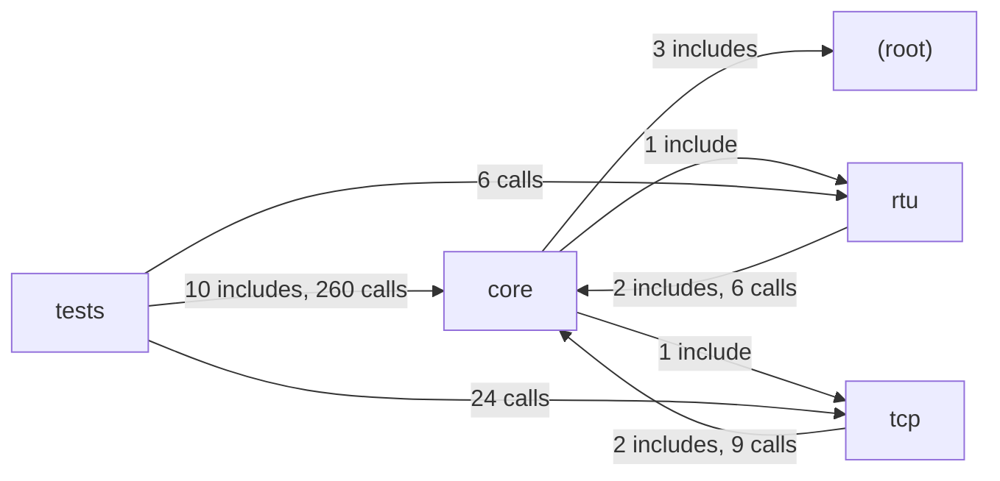

# Module map

Generated by `lcart map` from the fact database, without an LLM.

Translation units parsed: 14 of 14.

## Module dependencies

An arrow points from a module to a module it depends on. Its label counts
the include directives and direct calls that make the dependency.

## Modules

- `(root)`: 1 file, 0 function definitions
- `core`: 5 files, 68 function definitions
- `rtu`: 3 files, 26 function definitions
- `tcp`: 3 files, 26 function definitions
- `tests`: 11 files, 16 function definitions

### Module `(root)`

- `config.h`: 0 function definitions

### Module `core`

- `src/modbus-data.c`: 13 function definitions
- `src/modbus-private.h`: 0 function definitions
- `src/modbus-version.h`: 0 function definitions
- `src/modbus.c`: 55 function definitions
- `src/modbus.h`: 0 function definitions

### Module `rtu`

- `src/modbus-rtu-private.h`: 0 function definitions
- `src/modbus-rtu.c`: 26 function definitions
- `src/modbus-rtu.h`: 0 function definitions

### Module `tcp`

- `src/modbus-tcp-private.h`: 0 function definitions
- `src/modbus-tcp.c`: 26 function definitions
- `src/modbus-tcp.h`: 0 function definitions

### Module `tests`

- `tests/bandwidth-client.c`: 2 function definitions
- `tests/bandwidth-server-many-up.c`: 2 function definitions
- `tests/bandwidth-server-one.c`: 1 function definition
- `tests/proxy-test-client.c`: 1 function definition
- `tests/proxy-test-server.c`: 1 function definition
- `tests/random-test-client.c`: 1 function definition
- `tests/random-test-server.c`: 1 function definition
- `tests/unit-test-client.c`: 5 function definitions
- `tests/unit-test-server.c`: 1 function definition
- `tests/unit-test.h`: 0 function definitions
- `tests/version.c`: 1 function definition
