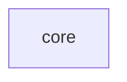

# A module map that does not parse

The first block is valid; the second has an edge label whose closing `|` is
missing.



```mermaid
flowchart LR
    m0["core"]
    m1["tests"]
    m1 -->|"3 includes" m0
```
